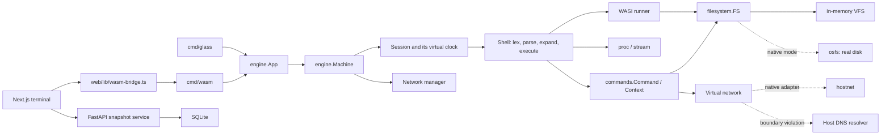

# GlassBox

A virtual Linux environment you can explore in your browser or run from your terminal. GlassBox brings together a Go shell, simulated filesystem, users, processes, and networking in one portable machine. It runs in WebAssembly in the browser and as a native Go CLI.


## Explore a Linux-like machine

<details>
<summary>Watch the terminal demo</summary>


</details>

Start a shell, inspect the filesystem, create files, change permissions, and connect commands with pipes. GlassBox gives you a hands-on place to explore how familiar Linux concepts fit together, without booting a virtual machine.

```sh
ls -l /
echo hello > greeting.txt
cat greeting.txt
```

The machine is simulated. Its shell and operating-system behavior run in the GlassBox engine, with an in-memory filesystem by default. The browser runs the same Go engine compiled to WebAssembly.

## Features

- A shell with pipelines, redirection, `if`/loops/`for`, functions, `source`, globbing and job control (`&`, `jobs`, `fg`, `bg`, Ctrl-Z, Ctrl-C).
- An in-memory filesystem with owners, groups, permission bits, hard links and `/dev` devices.
- Users and login (`/etc/passwd`, `/etc/shadow`, `su`).
- A process table with PIDs, signals and `ps`/`kill`.
- About 20 commands: `cat`, `cd`, `chmod`, `chown`, `cp`, `cut`, `date`, `echo`, `ls`, `mkdir`, `mv`, `rm`, `wc`, and more. Type `help` to list them.
- Session save and restore, with an optional FastAPI backend backed by SQLite.
- Virtual networking and DNS

## Try it

You need Go 1.25.4 or newer.

```sh
go run ./cmd/glass                 # start the simulated machine
go run ./cmd/glass script.sh a b   # run a script with arguments
go run ./cmd/glass --help          # see usage
```

### In the browser

You also need Node 22 or newer.

```sh
GOOS=js GOARCH=wasm go build -o web/public/engine.wasm ./cmd/wasm
cd web
npm install
npm run dev
```

`./deploy.sh` builds the engine and deploys the static site to Cloudflare Pages. It needs `npx wrangler login` first. Run or deploy the Python 3.12 FastAPI backend separately; see [backend/README.md](backend/README.md).

## Simulated machine runtime

The CLI and browser use `internal/engine.Machine` through the compatible `App` API.
Go hosts can manage an individual machine explicitly:

```go
machine, err := engine.NewMachine("lab-a")
if err != nil { return err }
if err := machine.Start(); err != nil { return err }
result := machine.Execute("echo hello > greeting")
_ = result
if err := machine.Stop(ctx); err != nil { return err }
if err := machine.Start(); err != nil { return err } // greeting still exists
```

A restart preserves files, identity, and virtual clock settings, and creates a fresh
shell, process table, and loopback network. Shell variables, history, working directory,
login identity, external interfaces, and published ports reset. Reattach external
networking after each boot. Machine IDs are assigned by the caller; uniqueness is
not enforced across instances.

`Stop(ctx)` cancels machine work and waits for actual workers and network cleanup.
A timeout leaves the machine `stopping` until cleanup finishes; another `Stop` can
wait again. `Info()` remains available during execution. Commands and session changes
are serialized per machine; separate machines can execute independently. Snapshot
restore replaces the session and network after cleaning up old background work.
Snapshots capture filesystem and shell state, not running processes or machine IDs.

Hosts can share one `wazero.CompilationCache` by passing it to each machine's
`SetWasiCache` before executing commands. The cache survives restart and restore;
stop all borrowing machines before closing it. Every program execution gets its
own wazero runtime and guest memory. NewApp and NewAppOn create an in-memory cache
owned by their Machine; NewMachine leaves cache setup to its caller. Machine.Close stops the machine and
closes that default cache. Use Stop for restart and Close for final cleanup.
Caller-supplied caches remain caller-owned.

The browser exposes `shutdown(): Promise<boolean>` for explicit cleanup. Tab termination
does not guarantee that cleanup finishes. There is no cluster manager or systemd dependency.

## Development workflow

- Branch from `develop`. Use `feature/*` for new features and `bugfix/*` for
  fixes. Open pull requests back into `develop` and keep each PR focused on
  one change that can be reviewed on its own.
- Put simulated Linux behavior in the Go engine. Keep the native CLI and
  browser bridge thin, and avoid using host resources to implement simulated
  behavior.
- Verify the entry points your change affects. If you change the engine,
  check both the native CLI and WebAssembly builds.
- Use `main` for releases. After checking the release candidate, merge
  `develop` into `main` and tag the release commit, for example `v0.1.0`.

## Check your changes

```sh
go build ./... && go vet ./... && go test ./...
GOOS=js GOARCH=wasm go build -o /dev/null ./cmd/wasm   # the engine must still compile to WASM
gofmt -l .                                             # must print nothing
```

## How it is organised



```text
web/          Next.js terminal (presentation only)
cmd/wasm      thin browser adapter
cmd/glass     native command line
internal/engine/
  shell/      lexer, parser, executor, jobs
  commands/   one file per command
  filesystem/ filesystem interface
  vfs/        in-memory filesystem
  osfs/       real disk filesystem (explicit native mode)
  stream/     files, descriptors, pipes
  proc/       process table and signals
  user/       accounts and passwords
  network/    network and dns
backend/      FastAPI snapshot service backed by SQLite
```

The rule that shapes everything: the engine must never use the host operating system to implement a feature, and it must always compile to WebAssembly.

## TODO
- [ ] Add command snapshot inside cli like browser
- [ ] Run wasm program inside glassBox
- [ ] Add package and plugin manager
- [ ] Complete remain engine features inside frontend
- [ ] Unittest
- [ ] Implement mount
- [ ] Extend simulated services and resource limits.
- [ ] Resource model (memory, CPU), atomic Move.


## License

See [LICENSE](LICENSE).
